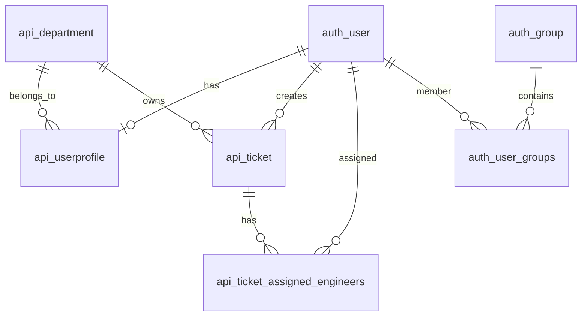

# Dokumentasi Database Helpdesk

Tanggal pengecekan: 20 Juni 2026

## Kesimpulan

Project Helpdesk saat ini menggunakan PostgreSQL sebagai database aktif.
Konfigurasi Django berada di `backend/backend/settings.py` dan menunjuk ke:

- Engine: `django.db.backends.postgresql`
- Database: `helpdesk_db`
- Host: `localhost`
- Port: `5432`
- Schema PostgreSQL: `public`

File SQLite `backend/db.sqlite3` memang ada, tetapi kosong. Pada saat dicek:

- Ukuran file: 8192 bytes
- Jumlah tabel SQLite: 0

Jadi, tabel aplikasi yang benar berada di PostgreSQL, bukan SQLite.

## Cara Melihat di pgAdmin

1. Buka pgAdmin.
2. Masuk ke server PostgreSQL lokal.
3. Buka `Databases`.
4. Pilih database `helpdesk_db`.
5. Buka `Schemas`.
6. Buka schema `public`.
7. Buka `Tables`.
8. Jika belum terlihat, klik kanan pada `Tables` lalu pilih `Refresh`.

Query SQL untuk memastikan tabel:

```sql
SELECT table_name
FROM information_schema.tables
WHERE table_schema = 'public'
  AND table_type = 'BASE TABLE'
ORDER BY table_name;
```

## Cara Cek SQLite

Dari folder `S:\project_helpdesk\backend`, jalankan:

```powershell
..\env\Scripts\python.exe -c "import sqlite3; con=sqlite3.connect('db.sqlite3'); print(con.execute(\"select name from sqlite_master where type='table' order by name\").fetchall()); con.close()"
```

Hasil pengecekan terakhir: `[]`, artinya tidak ada tabel di SQLite.

## Daftar Tabel PostgreSQL

| No | Tabel | Jumlah Data | Keterangan |
|---:|---|---:|---|
| 1 | `api_department` | 5 | Data departemen |
| 2 | `api_ticket` | 18 | Data tiket helpdesk |
| 3 | `api_ticket_assigned_engineers` | 25 | Relasi tiket dengan engineer yang ditugaskan |
| 4 | `api_userprofile` | 11 | Profil tambahan untuk user |
| 5 | `auth_group` | 3 | Role/group user dari Django |
| 6 | `auth_group_permissions` | 0 | Relasi group dengan permission |
| 7 | `auth_permission` | 36 | Permission bawaan Django |
| 8 | `auth_user` | 11 | Data akun pengguna |
| 9 | `auth_user_groups` | 6 | Relasi user dengan group |
| 10 | `auth_user_user_permissions` | 0 | Permission khusus per user |
| 11 | `django_admin_log` | 10 | Log aktivitas admin |
| 12 | `django_content_type` | 9 | Metadata model Django |
| 13 | `django_migrations` | 21 | Riwayat migrasi database |
| 14 | `django_session` | 2 | Data sesi login |

## Detail Tabel Aplikasi

### `api_department`

| Kolom | Tipe | Null | Keterangan |
|---|---|---|---|
| `id` | bigint | Tidak | Primary key |
| `name` | varchar(100) | Tidak | Nama departemen |

### `api_ticket`

| Kolom | Tipe | Null | Keterangan |
|---|---|---|---|
| `id` | bigint | Tidak | Primary key |
| `ticket_code` | varchar(20) | Tidak | Kode tiket, unik |
| `subject` | varchar(200) | Tidak | Subjek tiket |
| `description` | text | Tidak | Deskripsi masalah |
| `priority` | varchar(10) | Tidak | Prioritas: Low, Medium, High |
| `status` | varchar(20) | Tidak | Status: New, Assigned, In Progress, Resolved, Closed |
| `attachment` | varchar(100) | Ya | File lampiran |
| `created_at` | timestamptz | Tidak | Waktu tiket dibuat |
| `created_by_id` | integer | Tidak | Foreign key ke `auth_user.id` |
| `department_id` | bigint | Ya | Foreign key ke `api_department.id` |
| `handling_note` | text | Ya | Catatan penanganan |

### `api_ticket_assigned_engineers`

| Kolom | Tipe | Null | Keterangan |
|---|---|---|---|
| `id` | bigint | Tidak | Primary key |
| `ticket_id` | bigint | Tidak | Foreign key ke `api_ticket.id` |
| `user_id` | integer | Tidak | Foreign key ke `auth_user.id` |

Catatan: kombinasi `ticket_id` dan `user_id` bersifat unik.

### `api_userprofile`

| Kolom | Tipe | Null | Keterangan |
|---|---|---|---|
| `id` | bigint | Tidak | Primary key |
| `must_change_password` | boolean | Tidak | Penanda user wajib mengganti password |
| `department_id` | bigint | Ya | Foreign key ke `api_department.id` |
| `user_id` | integer | Tidak | Foreign key unik ke `auth_user.id` |

## Detail Tabel Django Bawaan

### `auth_user`

| Kolom | Tipe | Null | Keterangan |
|---|---|---|---|
| `id` | integer | Tidak | Primary key |
| `password` | varchar(128) | Tidak | Password terenkripsi |
| `last_login` | timestamptz | Ya | Login terakhir |
| `is_superuser` | boolean | Tidak | Status superuser |
| `username` | varchar(150) | Tidak | Username, unik |
| `first_name` | varchar(150) | Tidak | Nama depan |
| `last_name` | varchar(150) | Tidak | Nama belakang |
| `email` | varchar(254) | Tidak | Email |
| `is_staff` | boolean | Tidak | Akses admin site |
| `is_active` | boolean | Tidak | Status aktif user |
| `date_joined` | timestamptz | Tidak | Tanggal akun dibuat |

### `auth_group`

| Kolom | Tipe | Null | Keterangan |
|---|---|---|---|
| `id` | integer | Tidak | Primary key |
| `name` | varchar(150) | Tidak | Nama group, unik |

### `auth_permission`

| Kolom | Tipe | Null | Keterangan |
|---|---|---|---|
| `id` | integer | Tidak | Primary key |
| `name` | varchar(255) | Tidak | Nama permission |
| `content_type_id` | integer | Tidak | Foreign key ke `django_content_type.id` |
| `codename` | varchar(100) | Tidak | Kode permission |

### `auth_user_groups`

| Kolom | Tipe | Null | Keterangan |
|---|---|---|---|
| `id` | bigint | Tidak | Primary key |
| `user_id` | integer | Tidak | Foreign key ke `auth_user.id` |
| `group_id` | integer | Tidak | Foreign key ke `auth_group.id` |

### `auth_group_permissions`

| Kolom | Tipe | Null | Keterangan |
|---|---|---|---|
| `id` | bigint | Tidak | Primary key |
| `group_id` | integer | Tidak | Foreign key ke `auth_group.id` |
| `permission_id` | integer | Tidak | Foreign key ke `auth_permission.id` |

### `auth_user_user_permissions`

| Kolom | Tipe | Null | Keterangan |
|---|---|---|---|
| `id` | bigint | Tidak | Primary key |
| `user_id` | integer | Tidak | Foreign key ke `auth_user.id` |
| `permission_id` | integer | Tidak | Foreign key ke `auth_permission.id` |

### `django_admin_log`

| Kolom | Tipe | Null | Keterangan |
|---|---|---|---|
| `id` | integer | Tidak | Primary key |
| `action_time` | timestamptz | Tidak | Waktu aksi admin |
| `object_id` | text | Ya | ID objek yang diubah |
| `object_repr` | varchar(200) | Tidak | Representasi objek |
| `action_flag` | smallint | Tidak | Jenis aksi |
| `change_message` | text | Tidak | Pesan perubahan |
| `content_type_id` | integer | Ya | Foreign key ke `django_content_type.id` |
| `user_id` | integer | Tidak | Foreign key ke `auth_user.id` |

### `django_content_type`

| Kolom | Tipe | Null | Keterangan |
|---|---|---|---|
| `id` | integer | Tidak | Primary key |
| `app_label` | varchar(100) | Tidak | Nama aplikasi Django |
| `model` | varchar(100) | Tidak | Nama model |

### `django_migrations`

| Kolom | Tipe | Null | Keterangan |
|---|---|---|---|
| `id` | bigint | Tidak | Primary key |
| `app` | varchar(255) | Tidak | Nama aplikasi |
| `name` | varchar(255) | Tidak | Nama migration |
| `applied` | timestamptz | Tidak | Waktu migration dijalankan |

### `django_session`

| Kolom | Tipe | Null | Keterangan |
|---|---|---|---|
| `session_key` | varchar(40) | Tidak | Primary key |
| `session_data` | text | Tidak | Data sesi |
| `expire_date` | timestamptz | Tidak | Waktu sesi kedaluwarsa |

## Relasi Utama



## Hasil Verifikasi

Perintah yang sudah dijalankan:

- `python manage.py check`: sukses, tidak ada issue.
- `python manage.py showmigrations`: semua migration sudah applied.
- `python manage.py makemigrations --check --dry-run`: sukses, tidak ada perubahan model yang belum dibuat migration.
- `python manage.py test`: sukses, tetapi project belum memiliki test case.
- `npm run lint`: sukses.
- `npm run build`: sukses.

